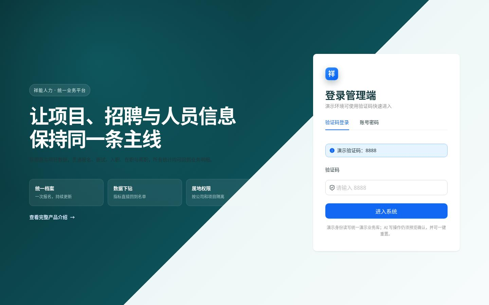
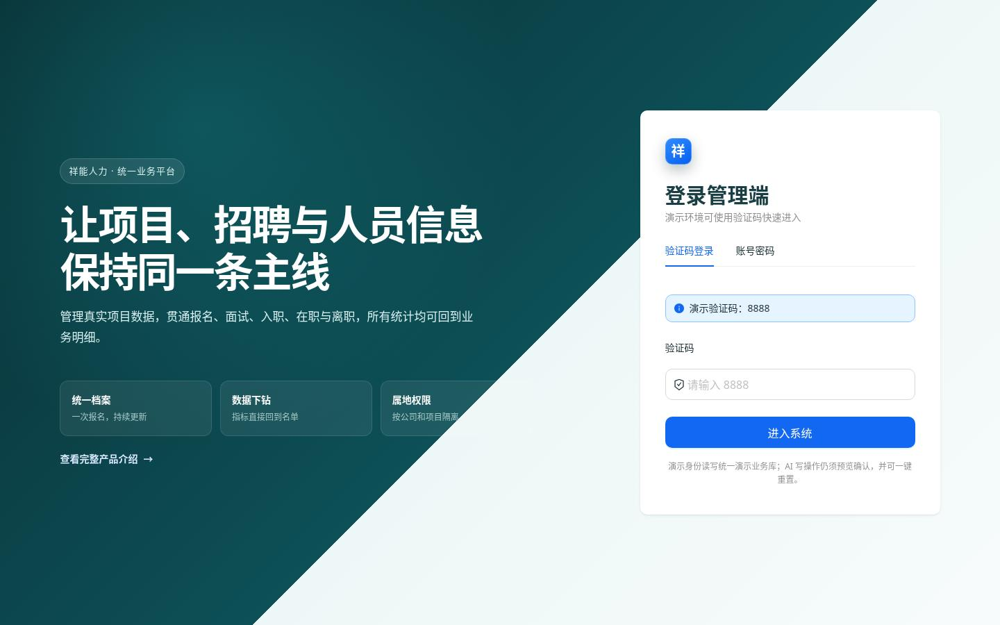
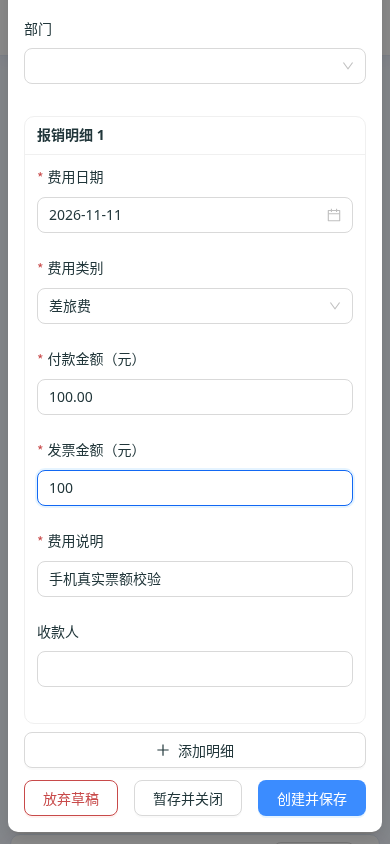
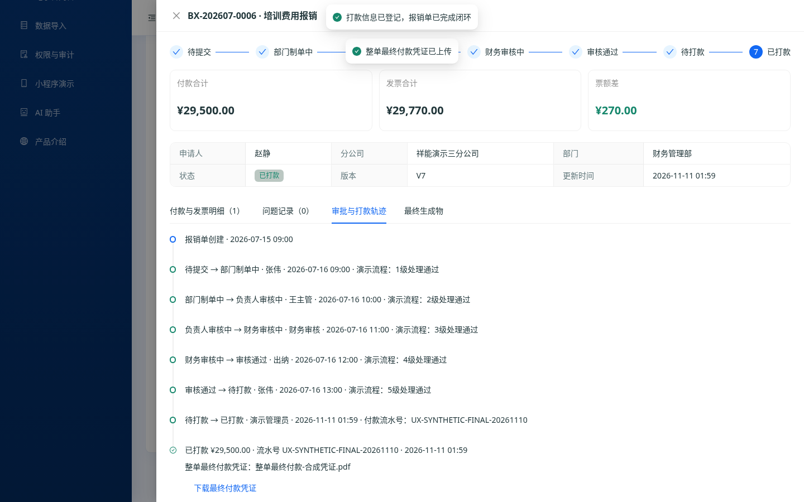

# 报销体验修复与验收 · 2026-11-11

## 变更

- 发票金额允许与付款等额；UI、演示层、API和导出说明统一为“不低于付款金额”，错误定位具体明细。
- 登记打款必须选择当前单据的整单最终付款凭证，不能复用明细截图或其他单据附件；事务内重新校验状态、版本、金额和凭证，统一写入付款、终态和审计。确认前显示待登记，结果可回查流水和凭证。
- 新建单据完整草稿按用户在当前标签页保留，Esc、遮罩和离页可继续；只有明确放弃才清空。上传回调绑定付款窗口与单据，旧上传不能替换新对象；本地清理失败不把已创建单据误报失败。
- 手机表单使用响应式栅格；头部演示工具在窄屏收起但仍可触摸访问；修复992px临界宽度的头部溢出。去掉不可输入的假搜索外观。
- 离线演示身份直接恢复，避免StrictMode重复恢复清空令牌；退出后旧身份响应失效，登录保留原路径、查询和锚点。登录说明使用真实组件class命中颜色与字号。
- 补齐Prisma的5个既有反向数组关系，使结构可验证；没有新增DB列或执行迁移。模块文档、局部上下文和架构索引同步更新。

## 同状态对照

以下均为1440×900、中文环境、首次打开且验证码为空的登录页。原说明实际颜色rgb(33,54,58)、字号14px；修复后rgb(216,239,240)、17px。对照原始截图局部背景，修复前正文对比约1.15:1。

| 修复前 | 修复后 |
|---|---|
|  |  |

[计算样式记录](login-comparison.json)。手机表单从原390px设备下514px文档宽度，修复至390px；日期可视输入从约11px到274px，主按钮完整可达。另测768px日期宽283px。设备模拟不是实体手机。

最终付款凭证、流水和结果轨迹：

## 实际验证

- 管理端Vitest：12文件42/42；原生Node8/8；类型检查和生产构建通过，保留已有大包警告。
- API Vitest：34文件129/129；原生Node41/41；Prisma validate通过。Vitest与node:test分别运行，默认test命令混收两种框架仍有既有No test suite found，不能视为默认命令全绿。
- 原生页面Chromium复走10组核心步骤：100/100保存、多明细错误修正、最终凭证必填与上传确认、双明细全部字段的Esc/遮罩/离页恢复、明确放弃、390/768输入修正和触摸模拟保存。无pageerror。[步骤与尺寸记录](acceptance.json)。
- 独立浏览器验证：存储拒绝清理仍显示成功；A上传延迟返回不会覆盖B单据或付款输入。
- 书签在1440/768/390保留查询与锚点；相邻人员页及报销页在992/1024/1199/1200/1440无外层溢出，菜单按钮36px。架构与索引检查通过。

复现管理端页面：本地启动Vite7501；指定已安装的PLAYWRIGHT_MODULE和可选CHROMIUM_PATH，执行 `node apps/admin/test/reimbursement-ux.browser.cjs`。脚本只接受loopback入口，强制演示登录离线回退，全部数据隔离为合成信息；截图和JSON默认放系统临时目录。可用REIMBURSEMENT_UI_URL和REIMBURSEMENT_EVIDENCE_DIR指定端口和证据目录。

## 边界

未接真实数据库、银行、正式角色或微信员工端，没有真实转账。全API项目类型检查仍有既有账号、权限、工作流及模型契约错误，不能宣称正式后端构建或生产全链路验收通过。本PR保持草稿，未合并部署。
